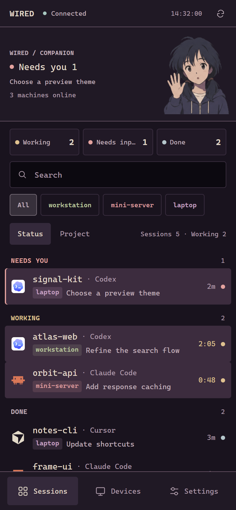
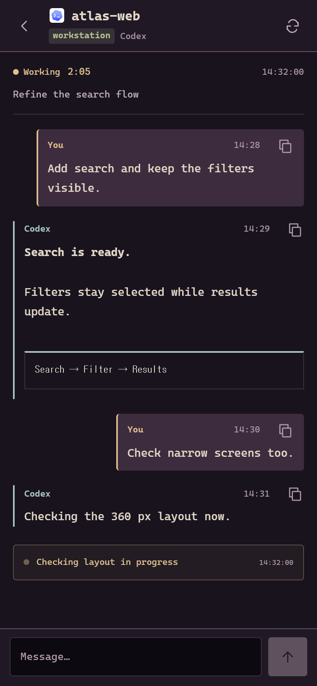
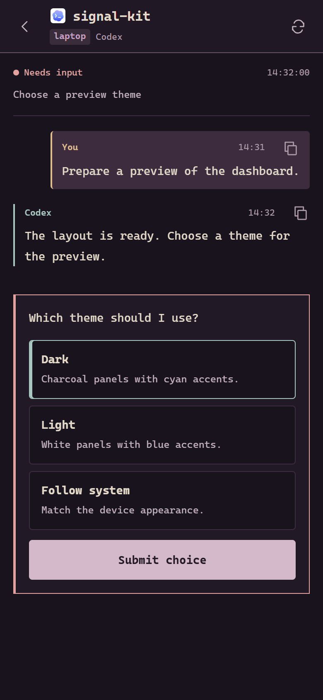
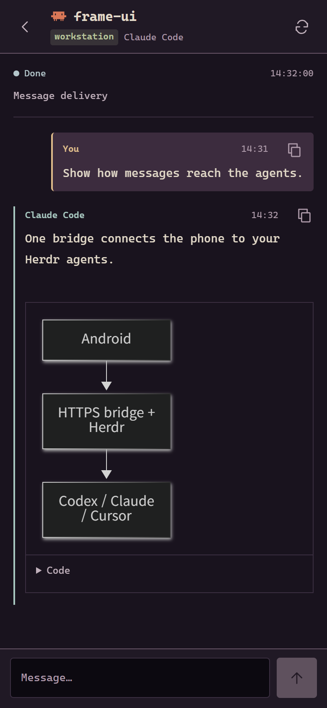
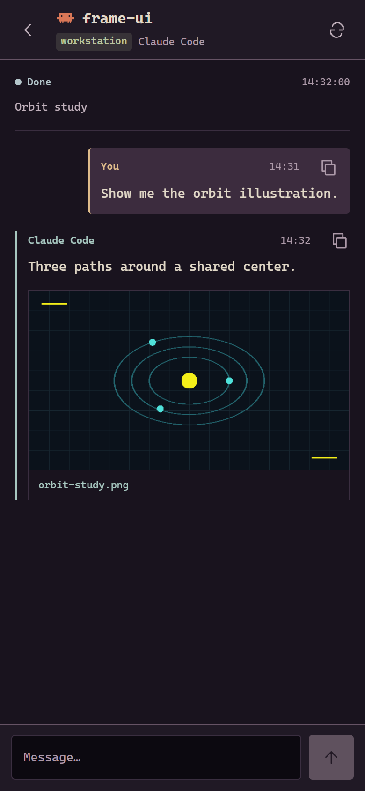
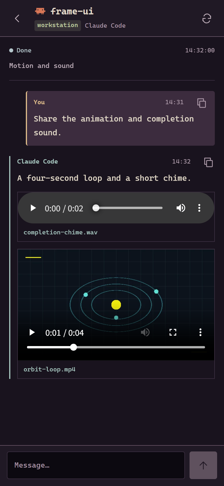

# Wired

Manage your Herdr agents across machines from Android. Formerly Herdr Pocket.

[한국어](docs/README.ko.md)

- Agent status and conversations across machines, with a companion avatar that reacts to them
- Messages and supported approval prompts
- Image, video, audio, and Mermaid previews
- Optional notifications with your own Firebase project

Supports Codex, Claude Code, and Cursor CLI. Available in English and Korean.

  
  
  

  
  
  

Screenshots use fictional sessions and messages. [Example files](docs/examples/).

## Get started

1. Set up Herdr and the bridge on your PC.
2. Build and install the Android app.
3. Connect with the bridge's HTTPS URL and token.

Tailscale is optional. See the [setup guide](docs/setup.md) for connection options.

## Documentation

- [Notifications](docs/notifications.md)
- [Development](CONTRIBUTING.md) · [Architecture](docs/architecture.md) · [Testing](docs/verification.md)
- [Security](SECURITY.md)

## License

[MIT](LICENSE) · [Third-party notices](THIRD_PARTY_NOTICES.md)
