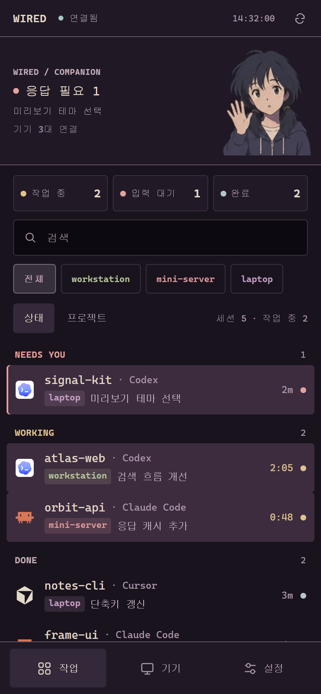
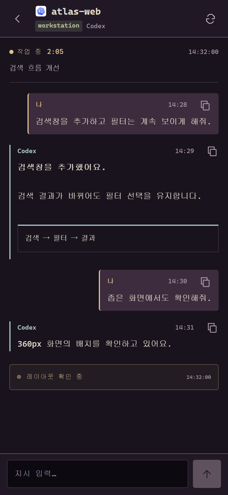
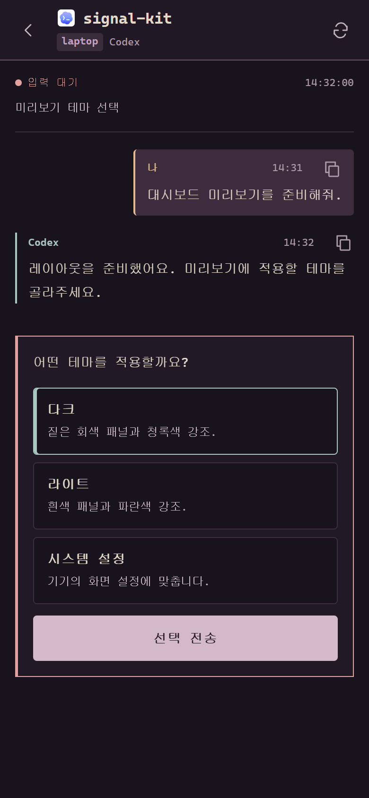
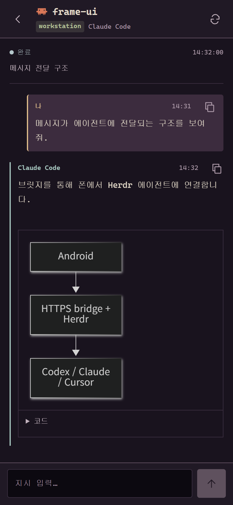
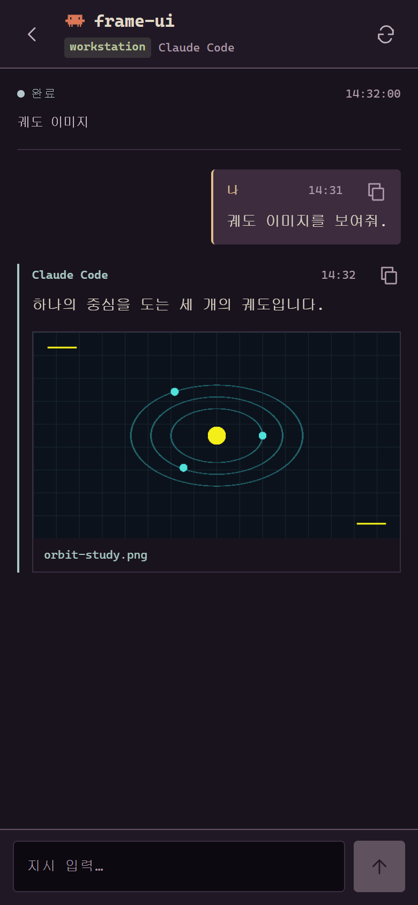
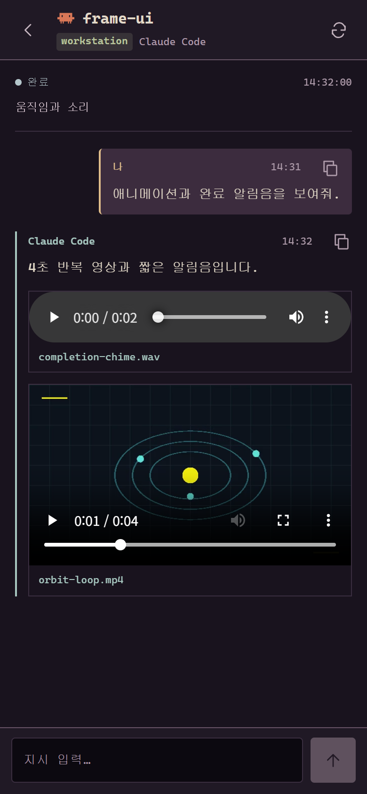

# Wired

여러 기기의 Herdr 에이전트를 모바일에서 통합 관리하는 Android 앱입니다. 이전 이름은 Herdr Pocket입니다.

[English](../README.md)

- 여러 기기의 에이전트 상태와 대화 확인, 상태에 반응하는 컴패니언 아바타
- 메시지 전송과 지원되는 승인 요청에 응답
- 이미지·영상·오디오·Mermaid 미리보기
- 본인 Firebase 프로젝트로 설정하는 알림(선택)

Codex, Claude Code, Cursor CLI를 지원합니다. 한국어와 영어로 사용할 수 있습니다.

  
  
  

  
  
  

스크린샷의 세션과 대화는 가상 데이터입니다. [예제 파일](examples/).

## 시작하기

1. PC에 Herdr와 브릿지를 설정합니다.
2. Android 앱을 빌드해 설치합니다.
3. 앱에 브릿지의 HTTPS 주소와 토큰을 입력합니다.

Tailscale은 선택 사항입니다. 연결 방법은 [설정 안내](setup.md)에 있습니다.

## 문서

- [알림 설정](notifications.md)
- [개발](../CONTRIBUTING.md) · [구조](architecture.md) · [테스트](verification.md)
- [보안](../SECURITY.md)

## 라이선스

[MIT](../LICENSE) · [서드파티 고지](../THIRD_PARTY_NOTICES.md)
